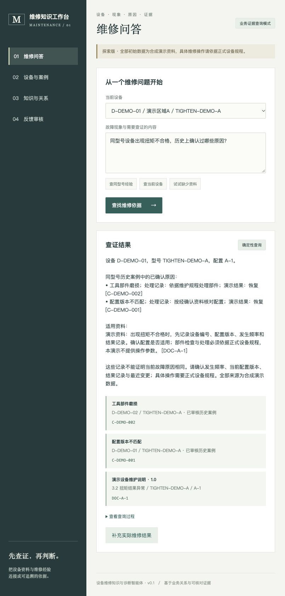

# 设备维修知识与诊断智能体

参考 [BeModel 本体建模平台](https://github.com/yueyezhufeng/bemodel-java) 的语义层、数据映射、证据追溯和知识治理思路，探索面向制造设备维修的智能体。

**当前状态：v0.1 可运行首版。Spring Boot 后端、维修工作台、本地持久化、查询证据和反馈审核已经实现。初始数据全部为合成演示数据，尚未在客户现场或生产负载下验证。**

## 启动

需要 JDK 21 或更高版本、Maven 3.9。默认仅监听本机，不需要先安装MySQL或前端构建工具。

```sh
mvn -s .mvn/settings.xml -gs .mvn/settings.xml verify
java -jar target/maintenance-ontology-agent-0.1.0.jar
```

打开 http://127.0.0.1:8087 。H2数据库保存在 `data/` 中，重启保留问答与反馈。`.mvn/settings.xml` 只使用公开Maven Central；已有可用的Maven配置时，可直接 `mvn verify`。

审核与资料发布默认关闭。启动前设置 `ADMIN_TOKEN` 为自选的强凭证，页面“反馈审核”输入同一凭证即可。不要将真实凭证提交到仓库。首版使用共享审核凭证，不是完整的人员权限系统；审核人姓名为人工填写。

## 接入模型

可选环境变量见 [.env.example](.env.example)；程序不会自动读取 `.env`，需在启动环境中设置。

- `MODEL_BASE_URL`：兼容接口的基础URL，例如内网服务的 `http://模型地址:端口/v1`。
- `MODEL_NAME`：服务中真实可用的模型名称。
- `MODEL_API_KEY`：有鉴权时配置；无鉴权的本地服务可以留空。

配置后，模型通过JSON协议选择 `get_device`、`search_cases`、`search_documents` 工具，最多4轮；引用必须来自已执行查询的结果。不配置模型时为确定性业务查询；服务不可用、协议错误或无效引用时回退到业务查询，并在页面说明。

模型调用会发送问题及查询到的设备、案例、资料文本。正式内网部署时应使用内网模型地址。引用ID检查不能保证模型叙述全部正确，仍需真实样本评估。

## 已实现与边界

| 能力 | 首版行为 |
|---|---|
| 设备与历史案例 | 参数化SQL；按设备/型号查询；仅已审核案例作为依据 |
| 文档知识 | 文本发布、型号与配置过滤、有效版本筛选、正文关键词匹配、来源展示 |
| 智能体 | 可选模型的有限工具调用、工具执行记录、无效引用回退 |
| 知识治理 | 提交反馈→待审核→通过或驳回；重复审核冲突；问答保留原始证据快照 |
| 持久化 | H2本地文件数据库，适合个人演示 |
| 界面 | 原生HTML/CSS/JavaScript，同一服务直接提供页面，无外部CDN依赖 |

首版故障识别只覆盖“扭矩不合格”及“拧紧不合格”示例，不是通用故障理解。未实现PDF/OCR、向量检索、学习式重排序、通用本体编辑/OWL推理、多轮会话记忆、NATS/飞书生产集成和企业级认证。上述能力不能作为已交付功能宣传。

可用 `/api/health` 查看模式；[API接口](docs/api.md)及[验证问题](docs/acceptance.md)见文档。

## 本地验证

2026-10-11：使用JDK 25编译为Java 21目标，`mvn verify`通过14项行为测试；打包程序通过HTTP烟测，覆盖设备范围、反馈审核、凭证检查和重启持久化；浏览器验证了正常查询、来源展示和无资料回答。

可在构建后运行 `python3 scripts/smoke.py` 重做打包烟测（另需Python 3）。真实模型连接、Docker镜像构建、客户数据效果与生产并发尚未验证。CI配置使用JDK 21，其运行结果以GitHub Actions为准。



## 核心场景

维修人员描述设备异常，系统关联设备档案、部件、故障现象、历史维修案例和技术资料，提出必要的追问，并生成带证据的排查建议。维修结束后，实际原因与处理过程经审核补充到知识库。

设备报警是可选输入。主场景是维修人员主动提问和跨资料、跨记录查证。

例如：

> 同型号的拧紧设备最近多次出现扭矩不合格，历史上有哪些确认原因？分别处理过什么？当前设备还需要确认哪些信息？

该问题需要将设备型号、维修记录、原因和资料版本关联起来，而不是只找一段相似文本。

## 参考 BeModel 的部分

| 参考思路 | 本项目设计 |
|---|---|
| 本体概念和关系 | 设备、型号、部件、故障现象、原因、动作、维修案例、资料 |
| 概念到物理数据映射 | 把不同设备台账、工单字段映射成统一业务含义 |
| 业务数据与文档知识双轨 | 结构化查询核对事实，文档检索补充维修依据 |
| 证据链与版本管理 | 回答展示记录ID、资料版本、适用型号和检索来源 |
| 工具调用 | 查设备、查历史、检索资料、请求澄清；逐步留痕 |
| 知识增长治理 | 未命中问题进入待补充队列，维修反馈审核后发布 |

本仓库独立实现，当前未复制 BeModel 源码，也不是其官方分支。后续如复用源码，应保留上游许可证和版权声明。

## 首版范围

- 设备档案和维修案例查询。
- 文档检索和来源引用。
- 有限轮数的只读工具调用与必要追问。
- 维修反馈、人工审核和知识版本。
- 演示用合成数据及验证问题。

生产集成阶段再对接客户现有 NATS 和飞书平台；数据采集、消息总线、推送平台不在本项目重建范围内。

## 内容导航

- [实现设计](docs/design.md)
- [验证问题](docs/acceptance.md)
- [合成设备档案](demo/devices.csv)
- [合成维修案例](demo/maintenance_cases.csv)

## 后续实施顺序

1. 用真实资料检验设备匹配、历史案例查询和回答依据。
2. 增加文档解析、OCR、向量检索和重排序，并评估样本效果。
3. 增加可编辑概念、字段映射和现象词典，取代首版固定领域规则。
4. 对齐客户NATS协议，接入飞书业务闭环。
5. 补全用户权限、数据库迁移、监控、备份和容量验证。

不将演示案例称为客户实际落地案例。实际设备维修动作以经确认的设备手册和现场人员判断为依据。
